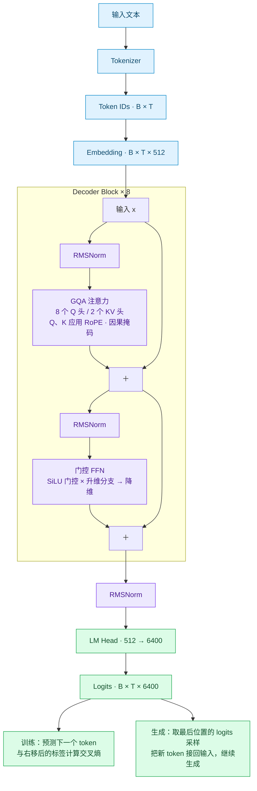

# TinyMind

跟着 [MiniMind](https://github.com/jingyaogong/minimind) 学习大模型，边读边手写，把模型、数据处理和训练过程走一遍。

这个仓库是在 MiniMind 基础上改编的，默认是一个约 **26M 参数**的中文语言模型。我主要想弄清楚：一句话进去以后，张量怎么变，注意力怎么算，最后又怎么变成下一个 token。代码里留了不少中文注释，具体学习笔记放在[个人博客](https://cultist123.github.io/)。

## 模型长什么样

8 层 Decoder，隐藏维度 512，8 个 Query 头共享 2 个 KV 头，词表大小 6400。输入 Embedding 和输出 LM Head 共享权重。



`B` 是 batch size，`T` 是序列长度。图中的两条跳线就是残差连接。实现主要在 [`model/TinyModel.py`](model/TinyModel.py)，参数在 [`model/__init__.py`](model/__init__.py)。

## 对应的学习笔记

- [MiniMind：模型实现与张量数据流](https://cultist123.github.io/posts/minimind/)：这个项目的主要笔记，记录 GQA、FFN、残差连接和模型里的张量变化。
- [RoPE 与 YaRN：位置编码与长度外推](https://cultist123.github.io/posts/rope-yarn/)：对应 `precompute_freqs_cis` 和 `apply_rotary_pos_emb`，单独拆开讲位置编码。
- [Transformer](https://cultist123.github.io/posts/transformer/)：注意力、多头、mask 和 FFN 的基础，可以先看这篇。

笔记里有些代码还叫 `MokioMind`，是早期的命名，现在仓库统一叫 TinyMind。感谢 MiniMind 原作者的开源代码和学习资源。

## 现在写到哪了

模型主体、预训练入口、文本生成入口已经写好，数据集部分有 Pretrain、SFT 和 DPO，LoRA 也有注入和保存加载的实现。

后面的训练阶段还在整理：部分 SFT / DPO / LoRA / PPO 脚本仍引用旧模块，SFT 的数据返回格式也需要和训练入口统一；GRPO 脚本还是空的。MoE 目前只有配置，没有专家网络，`eval.py` 也还没接入 LoRA 加载。

仓库暂时没有上传训练语料、模型权重和评测结果，下面保留的是预训练与生成入口的用法，还没有做完整的端到端验证。

## 跑一下

需要 Python 3.13+，依赖见 [`pyproject.toml`](pyproject.toml)。使用 uv：

```bash
git clone https://github.com/cultist123/TinyMind.git
cd TinyMind
uv sync
source .venv/bin/activate
```

自己准备一份 `dataset/pretrain.jsonl`，每行一个 `text` 字段：

```json
{"text": "这里放一段训练文本。"}
{"text": "每行是一条样本，训练时会分词、截断，并补齐到指定长度。"}
```

训练要进入 `trainer/` 目录，分词器和权重路径目前按这个工作目录读取：

```bash
cd trainer
python train_pretrain.py \
  --data_path ../dataset/pretrain.jsonl \
  --save_dir ../out \
  --from_weight none \
  --batch_size 4 \
  --max_seq_len 512 \
  --epochs 1
```

脚本会优先选择 CUDA，其次 MPS，最后 CPU，也可以用 `--device` 指定。内存不够就先减小 batch size 或序列长度。默认权重存到 `out/pretrain_512.pth`，恢复训练的状态存在 `checkpoints/`，续训参数是 `--from_resume 1`。

拿到权重后，回到根目录试生成：

```bash
cd ..
python eval.py --weight pretrain --max_new_tokens 128 --device cpu
```

选 `0` 跑预设问题，选 `1` 自己输入，空行退出。有 NVIDIA GPU 可以改成 `--device cuda`；当前推理入口遇到 MPS 会回退到 CPU。预训练模型先学的是续写，聊天还需要后续指令微调。

## 代码从哪里看

```text
model/TinyModel.py         RMSNorm → RoPE → GQA → FFN → 完整模型
model/__init__.py          模型配置
dataset/lm_dataset.py      分词、padding、标签与 loss mask
trainer/train_pretrain.py  预训练循环
trainer/trainer_utils.py   初始化、学习率、检查点与分布式工具
eval.py                   加载权重与生成
model/model_lora.py        LoRA 适配器
torch_methods/            写模型时用到的 PyTorch 基础操作练习
```
